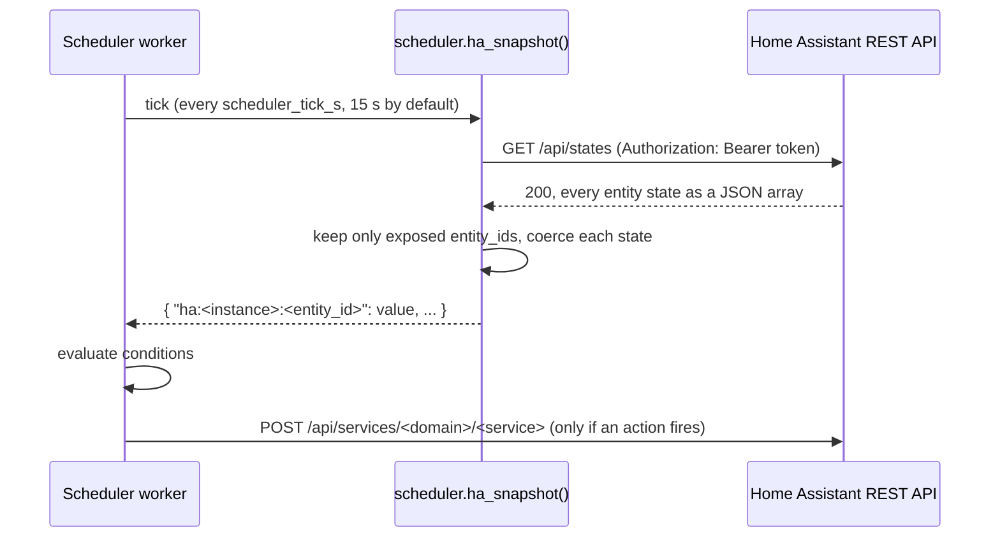

# Reading Home Assistant

[Developers Guide](index.md) · User guide: [Home Assistant setup and notifications](../guide/ha-setup-and-notifications.md)

The bridge reads from Home Assistant as well as publishing to it. It reads entity states
to use as Scheduler conditions and price inputs, and it calls Home Assistant services for
notifications and schedule actions.

!!! note "REST, not the websocket API"
    The bridge has **no Home Assistant websocket client**. Every call goes to Home
    Assistant's [REST API](https://developers.home-assistant.io/docs/api/rest/) with
    Python's `urllib.request` (`ha_instances.py`). Nothing in the package sends `auth`,
    `get_states`, `subscribe_events` or any other websocket message. The code says so
    itself: `ha_dashboard.py` notes that "there is no websocket client in this image",
    and the Integration Mapping catalogue in `app.py` lists **Home Assistant WebSocket**
    as `"implemented": False`, "To be implemented".

    So there are no subscriptions and no pushed state changes. The bridge **polls**.

Read from the code on `main` (0.5.2). Paths are relative to
`src/franklinwh_direct_connect_bridge/`.

---

## Home Assistant instances

The bridge keeps a list of Home Assistant instances in its SQLite store (table
`ha_instances`: id, name, base URL, token, default, enabled). Each call uses one
instance's base URL and token.

### The add-on's own Home Assistant

As an add-on, `config.yaml` asks for `homeassistant_api: true`, so the Supervisor gives
the container a `SUPERVISOR_TOKEN`. `ha_supervisor.self_instance()` returns an instance
with:

- name `Home Assistant (this add-on)`
- base URL `http://supervisor/core` (`SUPERVISOR_CORE_API`)
- the Supervisor token

`_seed_self_ha_instance()` in `app.py` runs at start-up. If the instance list is
**empty**, it adds that instance as the default. It never overwrites instances you have
configured.

### Any other Home Assistant

Add it with a base URL and a
[long-lived access token](https://developers.home-assistant.io/docs/auth_api/#long-lived-access-token):

```bash
curl -s -X POST http://<bridge-host>:8101/api/ha/instances \
  -H 'Content-Type: application/json' \
  -d '{"name": "Home", "base_url": "http://192.0.2.20:8123", "token": "<LONG_LIVED_TOKEN>", "is_default": true}'
```

The body model is `HaInstanceCreate` in `app.py`: `name`, `base_url`, `token`,
`is_default` (default false) and `enabled` (default true). Edits use
`PATCH /api/ha/instances/{id}`. There is no `PUT`. `POST /api/ha/test` probes a URL and
token. Given `ha_id` and a blank token, it tests with the stored token.

**Tokens are write-only.** Every route that returns an instance passes it through
`ha_instances.redact()`, which removes `token` and adds `has_token`. The token **is**
stored in plain text in the SQLite database. I did not check whether database backups
include it.

---

## The calls

All in `ha_instances.py`. Every request sends `Authorization: Bearer <token>` and times
out after 8 seconds (`TIMEOUT_S`).

| Function | Request | Used for |
|---|---|---|
| `probe()` | `GET /api/` | The connection test and the `ha_linked` setup check. A 401 or 403 becomes "token rejected". |
| `components()` | `GET /api/config` | The `ha_mqtt` setup check: is `mqtt` loaded? |
| `states()` | `GET /api/states` | Entity values for the Scheduler, and the entity browser. |
| `notify_targets()` | `GET /api/services` | The `notify.*` services, for picking a notification device. |
| `bridge_entities()` | `POST /api/template` | Counting the bridge's own entities in HA, by device identity. |
| `call_service()` | `POST /api/services/<domain>/<service>` | A schedule's Home Assistant service action. |
| `send_notification()` | `POST /api/services/notify/<name>` | Notification devices, with `{"title", "message"}`. |

A separate, older path sends Home Assistant **persistent notifications**:
`Notifier.notify()` in `notify.py` posts to
`<base>/services/persistent_notification/create`. It does not use the instance list. It
reads `SUPERVISOR_TOKEN` on every call and uses `http://supervisor/core/api`, or, outside
the add-on, the `HA_URL` and `HA_TOKEN` settings.

The message flow for one Scheduler tick, for one instance with exposed entities:



---

## Entity values for the Scheduler

**Exposing.** Only entities you **expose** are read for the Scheduler. The exposed set
is the `ha_exposed` table, keyed `<instance_id>:<entity_id>`, and set with
`POST /api/ha/entities/expose`. In the UI this is **Home Assistant → Browse entities**.

**Naming.** An exposed entity becomes the sensor id `ha:<instance_id>:<entity_id>`
(`scheduler.ha_sensor_id()`). `GET /api/schedules` lists them among the `sensors`, with
the instance's name as the group.

**Reading.** `scheduler.ha_snapshot()` runs on every tick of the Scheduler worker
(`scheduler_worker.py`; every `scheduler_tick_s` seconds, 15 by default, clamped to 5–60).
For each enabled instance that has exposed entities it calls `states()`: one full
`GET /api/states`, every tick, with no cache. It then keeps only the exposed entities.

!!! note "Cost on a large Home Assistant"
    `GET /api/states` returns every entity, however few you exposed. Exposing fewer
    entities does not make the request smaller, only the result the bridge keeps. The
    `ha_snapshot()` docstring says only exposed entities are read "so a scheduler ... would
    not hammer Home Assistant"; that is true of what is kept, not of what is fetched.

**Coercing.** Home Assistant states are strings. `_coerce()` in `scheduler.py` converts
them:

| State | Becomes |
|---|---|
| `on`, `true`, `open`, `home` | `1` |
| `off`, `false`, `closed`, `away` | `0` |
| `unavailable`, `unknown`, an empty state | no reading: the entity is left out of the snapshot |
| a number, such as `"12.5"` | `12.5` |
| anything else | the string, unchanged |

!!! note "Unavailable is treated as missing (from 0.5.4)"
    The Scheduler's rule is that a condition on a missing sensor is false
    (`evaluate()` in `scheduler.py`). From 0.5.4 an entity that is `unavailable` or
    `unknown` is treated the same way. Before 0.5.4 it was coerced to `0`, so
    `ha:...:sensor.price < 10` was **true** while the price sensor was down (#167).

**When Home Assistant cannot be reached**, `ha_snapshot()` catches the error and skips
that instance (`except Exception: continue`). Its sensors are then missing from the
snapshot, so every condition on them is false. There is no retry within the tick; the
next tick tries again.

**Prices.** A Home Assistant price entity can also feed `tariff.spot_price` and
`tariff.feed_in_price`, through `ha_price_snapshot()`. The `tick()` code applies it after
the built-in AEMO NEM price, so the Home Assistant price wins.

---

## Calling services

A schedule's Home Assistant actions use `call_service()` and `send_notification()`. See
[Use case: integrating with the Scheduler](scheduler-integration.md#calling-a-home-assistant-service-as-an-action).

Both return a result rather than raising. The outcome is written to the schedule's log
as text, such as `service light.turn_on: ok` or `notify 'Phone': token rejected`.

---

## Token refresh after an add-on update (#99)

The Supervisor gives each new container a new token, so after an update the stored
token for the add-on's own instance used to be rejected. Since the fix for #99 (closed),
`_seed_self_ha_instance()` in `app.py` handles it at start-up: when instances already
exist, any row whose base URL is `http://supervisor/core` and whose token differs from
the current `SUPERVISOR_TOKEN` gets the new token. The log line is "refreshed this
add-on's Home Assistant token (new container)". Instances you added yourself are never
changed.

What the code does **not** do:

- It refreshes **only at start-up**. Nothing re-reads the token while running, and
  nothing retries after a 401. The code assumes a new token means a new container. I
  did not check whether the Supervisor can rotate a token without restarting the
  container.
- A rejected token shows up as "token rejected" from `probe()`, `call_service()` and
  `send_notification()`. From `states()` it is an exception that `ha_snapshot()`
  swallows, so the Scheduler simply sees no values from that instance.
- The older `Notifier` (persistent notifications) reads `SUPERVISOR_TOKEN` from the
  environment on each call, so it is unaffected.

---

## Related endpoints

| Method and path | Purpose |
|---|---|
| `GET /api/ha/instances` | List instances (tokens redacted). |
| `POST /api/ha/instances` | Add an instance (201). |
| `PATCH /api/ha/instances/{id}` | Edit an instance. |
| `DELETE /api/ha/instances/{id}` | Remove an instance. |
| `POST /api/ha/test` | Probe a URL and token. |
| `GET /api/ha/entities` | Browse entities. Query: `instance`, `domain`, `search`, `topic`, `exposed`, `limit`. |
| `POST /api/ha/entities/expose` | Expose or hide an entity for the Scheduler. |
| `GET /api/ha/notify-targets` | The instance's `notify.*` services. |
| `GET`, `POST /api/ha/notify-devices`; `PATCH`, `DELETE /api/ha/notify-devices/{id}` | Notification devices. |
| `POST /api/ha/notify-devices/test`, `POST /api/ha/notify-devices/broadcast` | Send a test, or send to many. |
| `GET /api/setup/ha-checks` | The four Home Assistant setup checks. |
