# Scheduler

[Back to the guide index](README.md)

The Scheduler is the bridge's automation engine. A schedule is one rule, and every rule
has the same shape:

```
trigger  →  calendar restrictions  →  entry conditions  →  hold  →  priority  →  action(s)  →  exit
```

You can use as little of that as you like. "Switch to Self-Consumption at midnight" uses
only the first step and the action. The rest exists so that a rule which moves your
battery can be made to do so only when it should.

---

## 1. Trigger — when the window opens


Eight trigger types, confirmed from the running bridge (`GET /api/schedules` →
`trigger_types`):

| Trigger | What it means |
|---|---|
| `daily` | One `fire_at` time plus a duration, every day the calendar allows. |
| `window` | A list of start→end pairs. A window whose end is at or before its start wraps past midnight. |
| `weekly` | A time, restricted to chosen days of the week. |
| `monthly` | A time, restricted to a day of the month — clamped at month end, so "31" fires on the 30th or 28th rather than being skipped. |
| `once` | Fires on one date, then goes dormant. |
| `interval` | Every N minutes, from an optional anchor time. |
| `cron` | A cron expression. Needs the `croniter` package; the UI reports whether it is available (`cron_available` was `true` on the bridge read live). |
| `always` | **No time window at all.** The entry conditions *are* the window — it acts whenever they hold and ends when they stop. |

Everything except `interval`, `cron` and `always` resolves to one or more daily time
windows. A duration of zero means a single instant rather than a window.

Windows that cross midnight are handled properly, and the occurrence is attributed to the
day the window *opened* — so a 22:00 window lasting 300 minutes is still "yesterday's
run" at 01:00, and recurrence is judged against the opening day.

### Calendar restrictions


Every recurrence field is a **restriction**, and leaving it empty means *no* restriction:

- days of the week
- months
- day of the month
- a start date and an end date

A rule that is blocked by one of these reports why — "not one of its days of the week",
"after end date 2026-12-31" — rather than quietly doing nothing.

### How fast can a schedule react

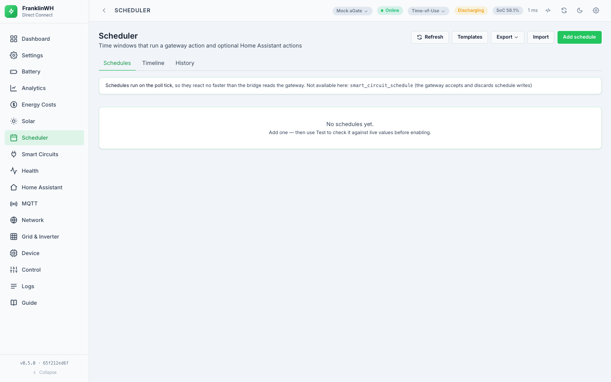

The scheduler is driven by the poll loop, so **a rule cannot react faster than the bridge
reads the gateway**. The tick cadence is its own setting (`scheduler_tick_s`, default 15
seconds) rather than being derived from the poll interval, and the UI validates that a
window is long enough to be observable. The Scheduler tab says "Schedules run on the poll
tick" for this reason.

### Which clock

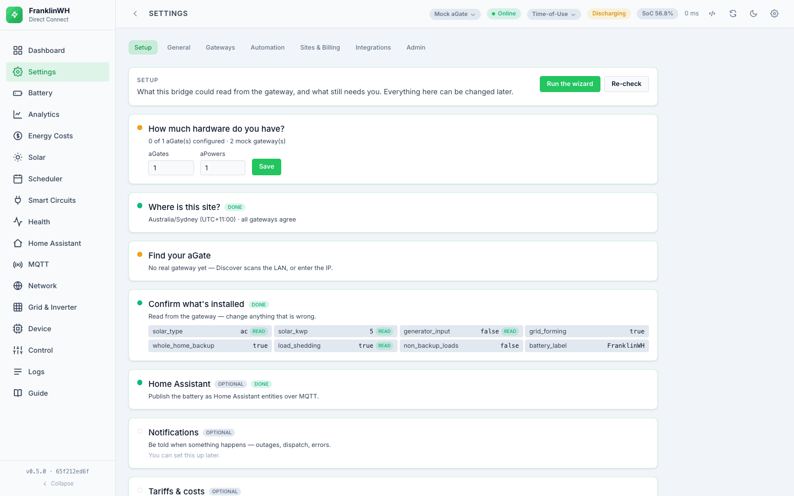

Schedule *rules* are evaluated in the **site's** wall-clock time — the aGate's timezone,
not the container's. If the gateway cannot be read, the bridge falls back to
container-local time. The audit trail and logs, by contrast, are in bridge-host time.
`docs/TIMEZONES.md` has the full picture.

---

## 2. Conditions — the gate

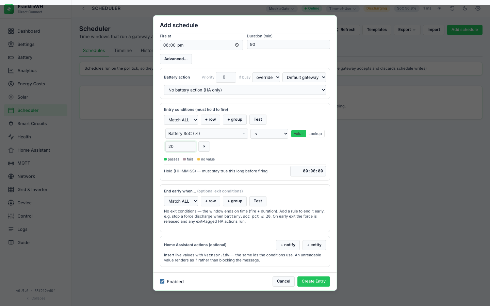

A condition tree answers one question: *should this rule act right now?* Two trees are
available per rule: **entry conditions** (the "Only if" box) and **exit conditions**
("End early when…").

### Operators

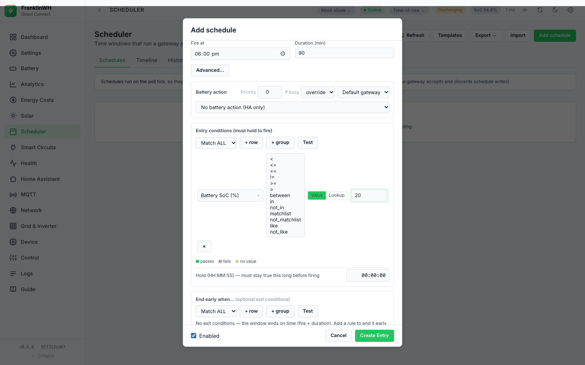

Thirteen, confirmed live (`ops` from `GET /api/schedules`):

| Operator | Notes |
|---|---|
| `<` `<=` `==` `!=` `>=` `>` | `==` compares numerically when both sides are numbers, exactly for booleans, and case-insensitively otherwise — so `mode.name == self-consumption` matches. |
| `between` | Inclusive, and order-independent. |
| `in` / `not_in` | Numeric membership. Members can be scalars or inclusive ranges written `20-40` or `20..40`. |
| `matchlist` / `not_matchlist` | Verbatim name lists, case-folded, with no range parsing — so `Self-Consumption` stays one name. |
| `like` / `not_like` | Case-insensitive wildcards: `*` or `%` for many, `?` or `_` for one. A pattern with no wildcard falls back to a substring test. |

The six list- and pattern-style operators take a raw member list on the right, so the
**Value / Lookup** toggle is hidden for them.

### Value or Lookup

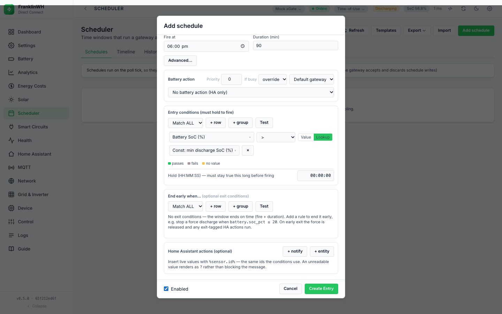

The right-hand side can be a literal **Value** or a **Lookup** — another sensor's live
value. `battery.soc_pct > const.min_discharge_soc` is a lookup comparison, and keeps the
threshold in one place instead of copied across rules.

### ALL / ANY, and nesting

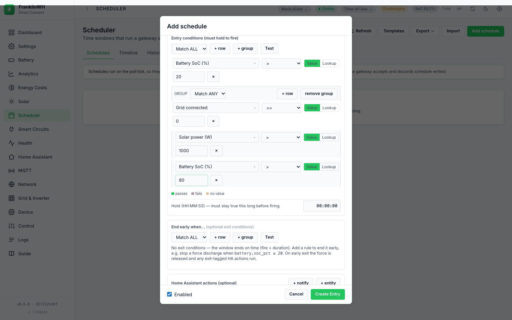

Rows combine with **Match ALL** or **Match ANY**, and they nest into groups, so
"(A and B) or C" is expressible. An empty ALL group is true; an empty ANY group is false.

### The rule that matters most

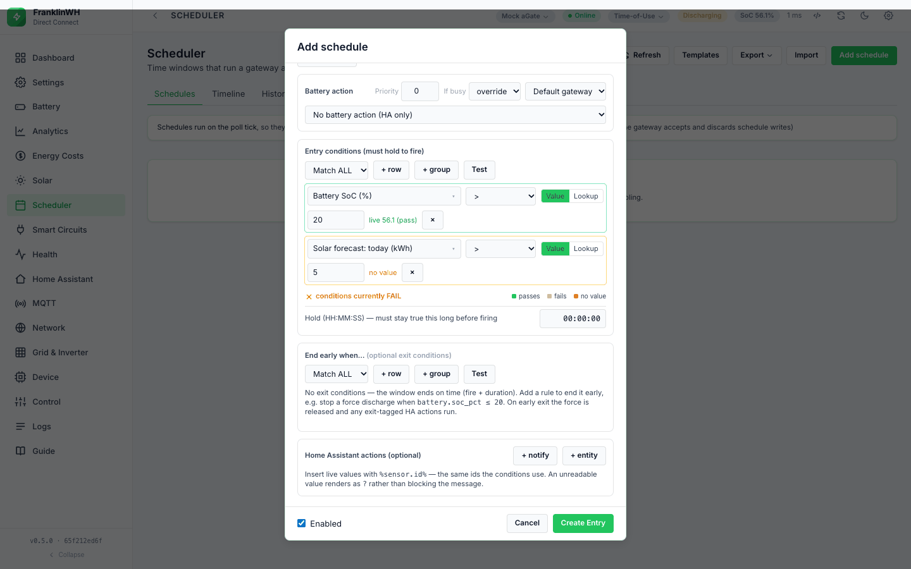

**A missing or unreadable value is FALSE for every operator — including `!=`.** A
scheduler must never act on data it does not have. The same applies to the right-hand
side of a Lookup: if the sensor it names cannot be read, the leaf fails closed. This is
why a rule can appear to "do nothing" when a sensor briefly goes unavailable, and it is
deliberate.

### What you can gate on

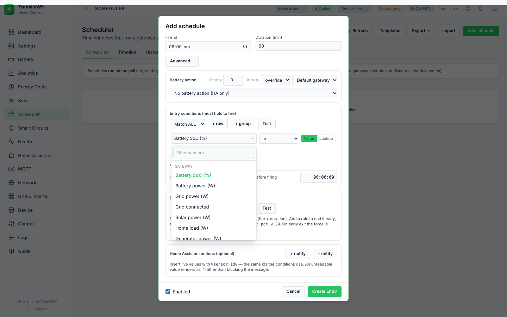

The sensor picker is grouped. On the bridge read live on 2026-10-15 it offered **196
sensors** across eleven groups:

| Group | Count | Examples |
|---|---|---|
| Gateway | 15 | `battery.soc_pct`, `battery.power_w`, `grid.power_w`, `grid.connected`, `solar.power_w`, `load.power_w`, `generator.power_w`, `mode.name`, `status.run_status`, `status.run_status_desc`, `status.vpp`, `status.off_grid`, `status.debug`, `status.programme_id`, `bridge.latency_ms` |
| Derived Battery | 10 | `battery.stored_kwh`, `battery.remaining_kwh`, ETAs to the charge/discharge targets at current and at max rate, solar-tracker percentages |
| Weather & Solar | 7 | `weather.temp_c`, `solar_forecast.today_kwh`, `solar_forecast.remaining_kwh`, `solar.today_kwh` (actual) |
| Tariff & Utility | 23 | the active tariff's rates, permissions and window flags |
| Demand / Tariff | 5 | peak and interval grid-import demand, demand charge to date |
| Energy | 5 | period import/export and cost |
| Fixed Charges | 5 | standing-charge accrual |
| System Setup | 8 | the derived install profile |
| Automation Constants | 4 | `const.min_discharge_soc`, `const.max_charge_soc`, `const.demand_charge_min_soc`, `const.default_operating_mode` |
| one group **per Home Assistant instance**, named after it | 114 across two instances | every HA entity you have **exposed** — see below |

Your counts will differ. The Home Assistant groups are named after your own instances
(the live bridge had two, contributing 113 and 1 exposed entities), so what you see there
is exactly what you exposed on the Home Assistant tab. The tariff groups depend on having
a tariff configured at all.

Two notes on specific sensors, taken from the code's own warnings:

- **`status.run_status`** is available both as a number and as text
  (`status.run_status_desc`). Use the number for an exact machine test, the text for a
  readable one and for message substitution. Documented values: 0 Standby, 1 Charging,
  2 Discharging, 5–7 off-grid, 8 Debug, 9 VPP.
- **`status.programme_id`**: `9` means VPP, but ordinary programmes use large arbitrary
  ids. So test `== 9`; never `!= 9` to mean "no programme".
- Booleans are exposed as `1`/`0` so they compare like everything else (`status.vpp == 1`).
- `grid.connected` is **derived** from grid power being non-zero, not a device field.

### Gating on Home Assistant

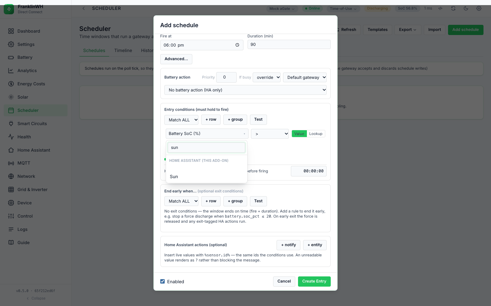

Any HA entity you expose on the **Home Assistant** tab becomes a scheduler sensor named
`ha:<instance>:<entity_id>`. Only exposed entities are read each tick — polling every
entity in a large HA install would hammer it. HA states are coerced for you: numeric
strings become numbers, and `on/true/open/home` → `1` while
`off/false/closed/away/unavailable/unknown` → `0`, so a binary sensor works in a `== 1`
condition.

---

## 3. Hold, and conflict resolution

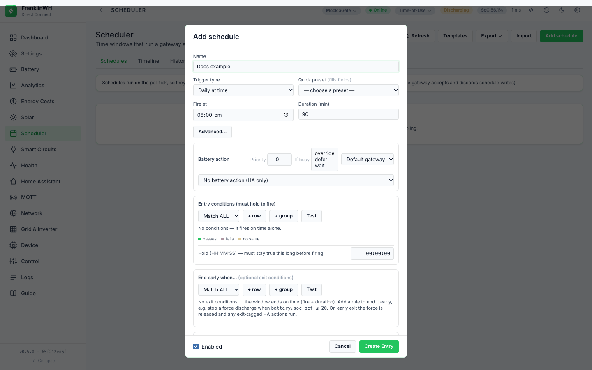

**Hold (`entry_hold_s`)** — the conditions must stay true *continuously* for this many
seconds before the rule fires. A rule that is waiting out its hold logs
"conditions met — holding Ns before firing"; if the conditions lapse, the timer resets. A
bridge restart restarts the hold, which is the safe direction.

**Priority** — when several rules become due on the same tick and want the same thing,
the highest priority wins and the others are deferred **with a reason that names the
winner**, e.g. *"deferred — 'Peak shaving' (priority 5) holds battery this occurrence;
this rule is priority 0"*.

Contention is per **resource**, not per gateway. This matters: `force`, `set_mode` and
`reserve_soc` contend with each other because they are one behaviour, whereas a rule that
only sends a notification claims nothing and never contends. A wildcard smart-circuit
claim is merged with the specific-circuit claims on the same gateway before a winner is
picked, so two rules that genuinely fight cannot each "win" their own group.

---

## 4. Actions — what the rule does

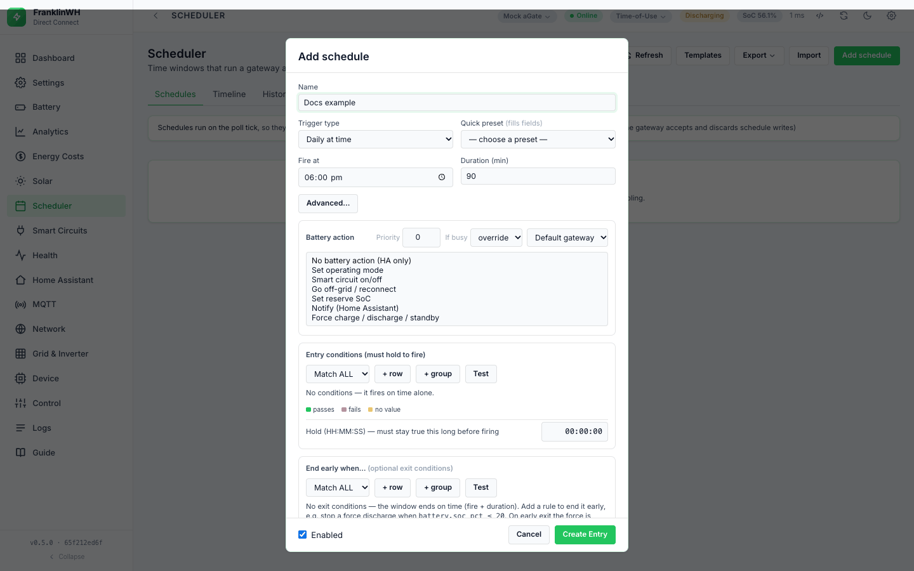

Six action kinds are offered (`actions` from `GET /api/schedules`), each with a note in
the code about how it is known to work:

| Action | Needs | Note from the code |
|---|---|---|
| **Set operating mode** | local | "1727 opt:3 — verified." |
| **Smart circuit on/off** | local | "1409 full-block RMW with read-back — verified 2026-08-08." |
| **Go off-grid / reconnect** | local | "consequential; confirm before enabling a schedule that uses it." |
| **Set reserve SoC** | **cloud** provider | "No local write path exists; needs cloud credentials." |
| **Notify (Home Assistant)** | a configured notification device | — |
| **Force charge / discharge / standby** | **Modbus** reachable | Runs for the schedule window, auto-releases at window end, and enforces the target SoC if set. |

One kind is listed as **unavailable, with the reason** rather than hidden:
`smart_circuit_schedule` — *"the gateway accepts and discards schedule writes"*. The
principle throughout is that offering a control which silently does nothing is worse than
not offering it, so an unavailable action is shown greyed with its reason.

### The force action in detail

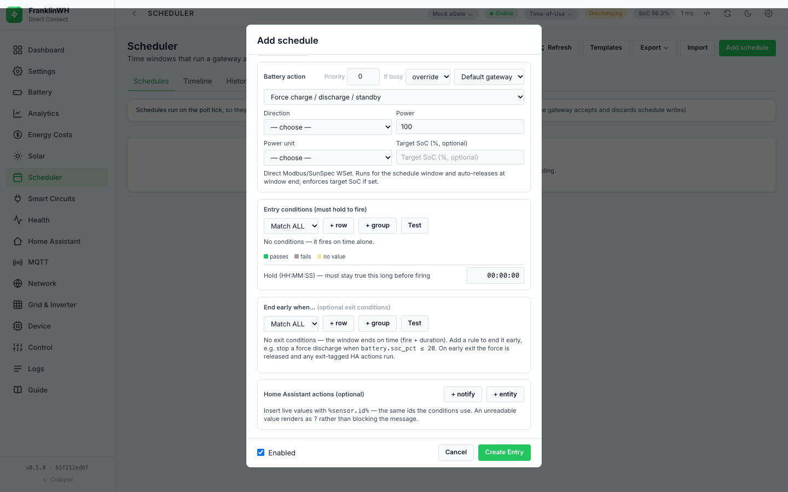

It runs for the schedule's **window**, not for a duration you set separately. The
bridge's watchdog releases at the window's end and enforces the **target SoC** — charge
stops at SoC ≥ target, discharge at SoC ≤ target — reading live SoC from that gateway's
last poll. The window's closing edge also fires a release as a safety net, so a force
never outlives its window.

Device-commanding actions (`force`, `set_mode`, `smart_circuit`, `offgrid`) are executed
as **writes** with a deadline: retried only while the fault looks transient, and **never**
retried once the outcome is unknown. An ambiguous first force-charge is not followed by a
second one.

### Home Assistant actions

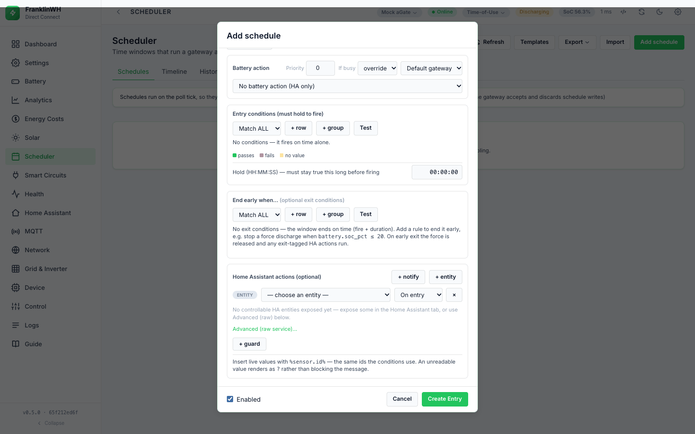

In addition to the gateway action, a rule can carry any number of **HA actions**, in
three flavours:

- **NOTIFY** — a message to a configured notification device.
- **ENTITY** — a guided service call: pick an exposed entity, and the editor offers the
  domain-appropriate control (turn on, turn off, toggle, set an option, press a button,
  run a scene or script).
- **SERVICE** — the raw form: domain, service, entity and a JSON payload.

Each HA action has a **when**: on entry, on exit, or both. Each can carry its own
**guard** — a condition that must hold at the moment it fires. And messages support
variable substitution: `%battery.soc_pct%` is replaced with the live value, using the same
sensor vocabulary as the conditions. A value that cannot be read renders as `?` rather
than blocking the message, on the grounds that a notification missing one field beats one
that never arrives.

---

## 5. Exit — ending the window

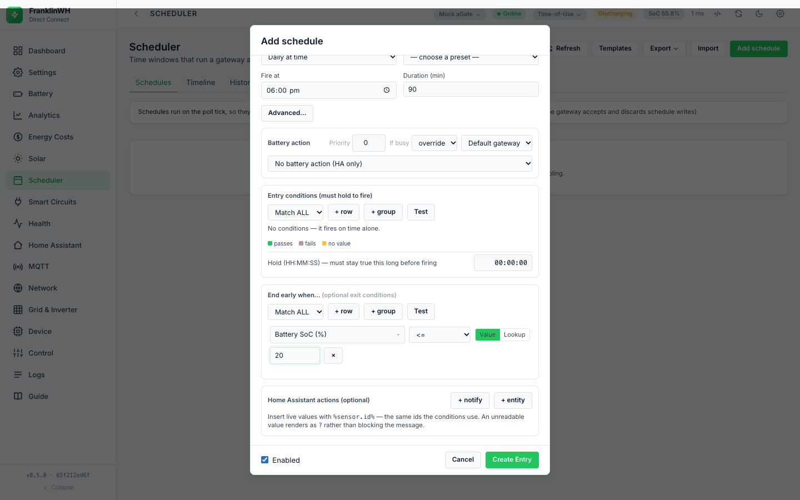

A window closes two ways: time runs out, or the **exit conditions** become true
mid-window. "End early when `battery.soc_pct <= 20`" stops a force discharge before it
drains the pack.

At the closing edge the bridge:

1. fires the exit-tagged HA actions (guards respected);
2. if **restore on exit** is set, puts back what the rule overrode;
3. releases a force dispatch, whether or not the action itself already ended;
4. logs an `exit` event saying which it was — "exit condition met" or "window closed".

**Restore on exit** is opt-in on purpose: "leave it where the rule left it" is a
legitimate intent, and turning restoration on by default would silently change what
existing rules do.

A rule whose exit condition already holds will not *start*; it reports "exit condition
already holds".

---

## 6. Working with schedules

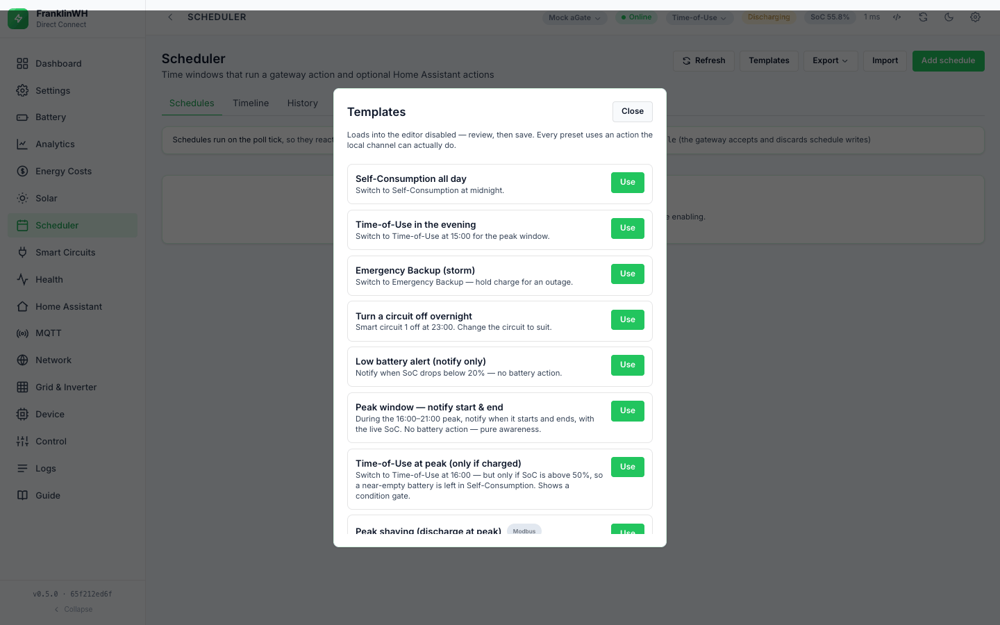

- **Templates** — built-in presets, loaded into the editor for review rather than fired
  blind. The local-only ones (mode switches, a circuit off overnight, a low-battery
  notification, a peak-window notify, "Time-of-Use at peak only if charged") need nothing
  special. Four more require Modbus: **Peak shaving**, **Battery Bonus export**,
  **Solar sponge** and **Off-peak charge** — each a force window with an SoC condition
  and a target-SoC floor.
- **Test against live** — evaluates the condition tree against the current snapshot and
  returns a trace with *one row per leaf*: the sensor, the operator, the resolved
  right-hand side, the live value and the result. There is no short-circuiting during a
  test, so you see every leaf, not just the first failure.
- **Run now** — fire the action immediately. **Stop** ends a running dispatch.
  **Pause / Resume** suspends a rule without deleting it. **Duplicate** copies it.
- **Planned windows** — a 24-hour timeline bar of today's enabled windows per rule, with
  the current time marked. Rules with no fixed daily window (`interval`, `cron`,
  `always`) do not appear on it, and nor do rules the calendar excludes today.
- **The log explains itself.** Besides fired and exit events, the engine records a
  `gated` event — *once a day*, not every tick — naming the first failing leaf and its
  live value, so "why did my rule do nothing?" has an answer in the UI.
- **Import / export.** Schedules export as a `franklinwh-local-schedules` bundle. The
  bridge also **imports the Modbus Bridge's `franklinwh-automations` bundles** and maps
  them field by field, and can convert its own rules back to that format. Import
  validation reports the whole bundle at once rather than failing on the first bad row,
  separating errors (a missing name, a `fire_at` that is not `HH:MM`, an unknown action)
  from warnings (a gateway or notify device that does not exist here, which you fix after
  import).

---

## 7. Using schedules from Home Assistant

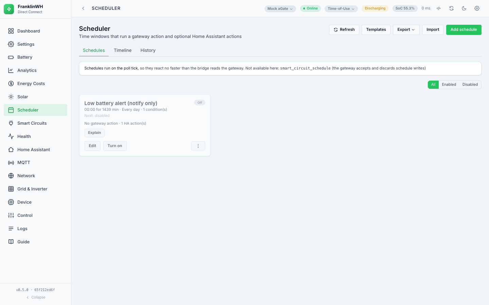

Everything the Scheduler tab does is also a REST call. Home Assistant can make those calls
with `rest_command`, so automations and scripts can read, create, update, delete, run and pause
schedules. Home Assistant entities for run, pause and state over MQTT are planned (#128).

**The address.** From Home Assistant, the add-on is reachable on its internal hostname. The
add-on's **Info** page shows it (for example `4a12892f-franklinwh-local-bridge`). Use
`http://<that hostname>:8101`. A Docker install uses its own host and port.

> The bridge's HTTP API has no login. Anything that can reach it can do all of the below.
> Keep it on a trusted network.

```yaml
# configuration.yaml
rest_command:
  fwh_schedule_create:          # body: a full schedule (see "The fields" below)
    url: "http://<hostname>:8101/api/schedules"
    method: POST
    content_type: "application/json"
    payload: "{{ schedule | tojson }}"
  fwh_schedule_update:          # replaces the schedule's definition
    url: "http://<hostname>:8101/api/schedules/{{ id }}"
    method: PUT
    content_type: "application/json"
    payload: "{{ schedule | tojson }}"
  fwh_schedule_delete:
    url: "http://<hostname>:8101/api/schedules/{{ id }}"
    method: DELETE
  fwh_schedule_run:             # runs its actions NOW, ignoring the window
    url: "http://<hostname>:8101/api/schedules/{{ id }}/run"
    method: POST
  fwh_schedule_pause:           # releases control but keeps the current run
    url: "http://<hostname>:8101/api/schedules/{{ id }}/pause"
    method: POST
  fwh_schedule_resume:          # re-enters a paused run while its window is open
    url: "http://<hostname>:8101/api/schedules/{{ id }}/resume"
    method: POST
  fwh_schedule_stop:            # releases this schedule's battery dispatch; stays enabled
    url: "http://<hostname>:8101/api/schedules/{{ id }}/stop"
    method: POST
```

**Reading.** A `rest` sensor on `GET /api/schedules` lists every schedule with `enabled`,
`next_fire` and `active_now`. `GET /api/schedules/runs` and `GET /api/schedules/log` give
what ran and why.

**Pause vs disable: they are different.**

| You want | Call |
|---|---|
| Stop the **current run** but keep it, to resume within its window | `pause`, then `resume` |
| Release a **battery dispatch** this schedule started, and leave the rule enabled | `stop` |
| Stop the rule from **firing at all** until further notice | `update` with `"enabled": false` |

**Run means real actions.** `run` does what the schedule does: a mode change, a smart
circuit, or a battery force. Test a new rule with `POST /api/schedules/{id}/test` first:
it evaluates the conditions and says what *would* happen, without acting.

**The fields** are those of the Scheduler tab's editor. A minimal rule that switches to
Self-Consumption at midnight:

```json
{"name": "Self-Consumption all day", "enabled": true,
 "fire_at": "00:00", "duration_min": 0,
 "action": {"kind": "set_mode", "mode": "self"}}
```

For anything more involved, build it in the Scheduler tab and **export** it
(`GET /api/schedules/export`): that is the exact JSON the API accepts.

## Multi-gateway behaviour

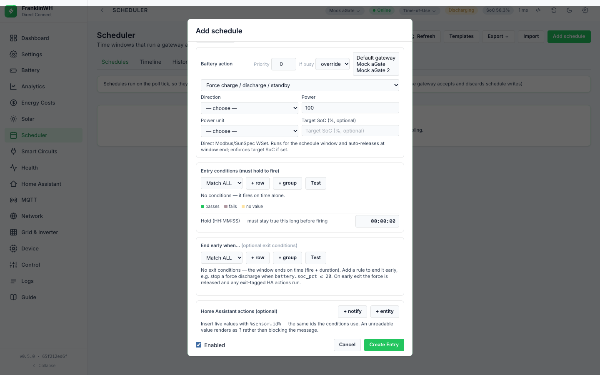

Covered in [Multi-gateway and sites](multi-gateway.md), but the short version:

- A rule **bound to a gateway** fires only on that gateway's tick.
- An **unbound** rule fires on the **default gateway's** tick only — so it does not run
  once per gateway on a multi-gateway site.
- A rule with **gateway scope "all"** is evaluated by every gateway on its own tick,
  producing one run and one resource claim per gateway.
