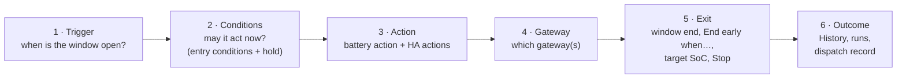

# Concepts

Direct Connect Bridge. Mirrors the Modbus Bridge page
[Concepts](https://david2069.github.io/franklinwh-modbus-bridge/user/scheduler/concepts/) section
for section.

How a schedule works, end to end. Read this first; the other pages go into each part.

!!! note "How to read the scheduler pages"
    These pages describe what the code of this release (0.5.5) does. Each behaviour has a
    hidden marker in the page source with the code location and whether a unit test covers
    it. Untested behaviour is described from the code, not from a test run. The
    [Scheduler test plan](../../dev/scheduler-test-plan.md) lists every behaviour with its
    test status, and [Scheduler parity](../../dev/scheduler-parity.md) compares it with the
    Modbus Bridge.

## The model

A schedule (also called a rule or an entry) is one card on the **Schedules** view of the
**Scheduler** tab. It has six parts, in this order:

| Part | Question it answers | Fields in the form | Page |
|---|---|---|---|
| **Trigger** | When is the window open? | Trigger type, its time fields, Duration (min) | [Triggers](triggers.md) |
| **Conditions** | May it act now? | Entry conditions (must hold to fire), Hold (HH:MM:SS) | [Conditions](conditions.md) |
| **Action** | What does it send? | Battery action and its parameters, Home Assistant actions | [Actions](actions.md) |
| **Gateway** | Which gateway or gateways? | the gateway picker (shown with more than one gateway); `gateway_scope` (API only) | [Targets](targets.md) |
| **Exit** | When does the window end, and what then? | End early when… (exit conditions); `restore_on_exit` (API only) | [Exit and release](exit-and-conflicts.md) |
| **Outcome** | What happened? | — (History, `GET /api/schedules/runs`, Logs) | [Outcomes and audit](outcomes.md) |

Two more settings decide what happens when schedules meet: **Priority** and **If busy**. See
[Priorities and conflicts](priorities.md).

## Three ways to start

| You want | Use | Example |
|---|---|---|
| **By time** | Recurring windows, One-off date, Daily, Weekly, Every N minutes, Monthly, Custom cron | Discharge 17:00–20:00 on weekdays |
| **By event** | A time trigger plus an entry condition on the thing that changes: a Home Assistant entity, `grid.connected`, `mode.name`, a tariff window flag | Notify when the grid drops, any time of day |
| **By sensor** | **Always (sensor-driven)**, or a short repeating trigger, with entry conditions on a sensor | Charge when the spot price is below 5 c/kWh |

There is no separate event trigger. An "event" is a condition that becomes true while the
window is open; the engine notices it on the next tick. Read the
[Always warning](triggers.md#always-evaluate) before using Always for a rule that should
act more than once.

## The tick

The scheduler is its own worker in the bridge, not the browser. It ticks every
`scheduler_tick_s` seconds (default **15**, held between 5 and 60 so a one-minute window
cannot be stepped over). A failing gateway does not stop the others, and a failing tick is
logged and the loop carries on. The tab's note "Schedules run on the poll tick" means
this: a schedule cannot react faster than the poller stores new values.
<!-- @b CON-01 ;; src: scheduler_worker.py:53-67, scheduler_worker.py:148-176, scheduler_worker.py:202-214 ;; tested: tests/test_scheduler_worker.py::test_cadence_is_clamped_so_no_expressible_window_can_be_missed ;; write: yes ;; b: The worker ticks every scheduler_tick_s (default 15, clamped 5-60) ;; test: -->

On each tick, for **each gateway** in turn:

| Step | What happens |
|---|---|
| 1 | Skip the gateway if it is disabled, has never polled, or its stored values are older than max(90 s, 3 × poll interval). |
| 2 | Build one sensor snapshot from the values the poller last stored, plus Home Assistant, tariff, forecast, constants and the derived sensors. |
| 3 | Read every schedule. Keep those that apply to this gateway: bound to it, unbound and this is the default gateway, or `gateway_scope` `all`. |
| 4 | For each: window open? already fired? entry conditions? hold? Collect those ready to fire. |
| 5 | Among the ready ones, one winner per resource by **Priority**; then **If busy** for force actions. |
| 6 | Run the winners, and write every decision to **History**. |

<!-- @b CON-08 ;; src: scheduler_worker.py:82-104, scheduler_worker.py:156-160 ;; tested: tests/test_scheduler_worker.py::test_a_stale_snapshot_is_skipped_with_a_reason ;; write: yes ;; b: A disabled gateway, one that never polled, or one whose snapshot is older than max(90 s, 3 poll intervals) is skipped with a reason ;; test: -->

Schedules are read in name order, every schedule including disabled ones; the enabled check is
part of step 4. Priority plays no part in the order; it only settles a contest between
schedules that are ready on the same tick.
<!-- @b CON-02 ;; src: db.py:871-875, scheduler.py:530-531, scheduler.py:2078-2118 ;; untested ;; write: no ;; b: The tick reads all schedules ordered by name; enabled is checked in due(); priority only applies among entries ready on the same tick ;; test: unit: two ready entries named so name order and priority order differ; assert the priority winner -->

Conditions read a snapshot built from the poller's stored values. They never ask the aGate
for a value. Other reads do happen on a tick: the site clock (at most every 10 minutes per
gateway), the Model 702 ratings over the Modbus client (this bridge) (cached for an hour),
and Home Assistant's state list.
<!-- @b CON-03 ;; src: scheduler_worker.py:107-116, scheduler.py:1947-1970, site_time.py:25, battery_control.py:449-475 ;; tested: tests/test_scheduler_worker.py::test_context_carries_the_snapshot_the_poller_wrote ;; write: no ;; b: The tick's snapshot is built from the poller's last_state for that gateway, not from a device read ;; test: -->

A schedule with **No battery action (HA only)** claims no resource and never competes with
battery schedules.
<!-- @b CON-04 ;; src: scheduler.py:2183-2212, scheduler.py:2084-2094 ;; tested: tests/test_scheduler.py::test_a_notify_rule_claims_nothing ;; write: yes ;; b: An entry without a gateway action claims no resource and never contends ;; test: -->

**Not in this bridge:** an immediate tick after a save. A saved, deleted or imported schedule
is picked up by the next regular tick (within 15 seconds by default), because the tick reads
the schedules from the database each time.
<!-- @b CON-05 ;; src: scheduler.py:1973, app.py:3089-3134 ;; untested ;; write: yes ;; b: Saving does not trigger a tick; the next regular tick reads the changed schedule from the database ;; test: unit (API): create an open-window entry; assert nothing is sent until tick_once runs -->

!!! warning "The Scheduler cannot be switched off as a module"
    **Not in this bridge:** a feature-module switch for the Scheduler. The worker starts with
    the bridge every time. To stop schedules, turn them off.
<!-- @b CON-06 ;; src: app.py:1180-1182 ;; untested ;; write: yes ;; b: The scheduler worker always starts with the bridge; there is no module switch ;; test: unit: app lifespan starts scheduler_worker.run -->

## Window, activation and run

| Word | Meaning |
|---|---|
| **Window** | The time the trigger keeps the schedule open. Recurring windows: the start → end you type. The other time triggers: *Fire at → Fire at + Duration (min)*. Always: while the entry conditions hold. An **End early when…** condition that is true closes it early. |
| **Occurrence** | One opening of the window, identified by a key (the date, `date#N` for the Nth recurring window, the slot time, the cron match, or `always`). A schedule fires at most **once per occurrence**. |
| **Run** | The record of one occurrence's attempt(s), in `GET /api/schedules/runs`: *pending*, *running*, *failed*, then *ok*, *missed*, *skipped*, *stopped* or *unknown*. A failed run is retried while the window is open. |

<!-- @b CON-09 ;; src: scheduler.py:369-392, scheduler.py:538-541, scheduler.py:2142-2156, db.py:1926-1933 ;; tested: tests/test_occurrences.py::test_a_failure_leaves_the_run_retryable_against_real_sql ;; write: yes ;; b: Each window opening is one occurrence; a run is claimed per occurrence and gateway, finished ok marks it fired, failed leaves it retryable inside the window ;; test: -->

## What the engine remembers

| Kept in memory (lost on restart) | Kept in the database (survives a restart) |
|---|---|
| hold timers, which windows were open last tick (for the closing edge), the key of the open window, the day a *gated* row was last written | each schedule's last fired occurrence and result, every run (occurrences), active force dispatches, History |

So after a restart a schedule that already fired in the current occurrence does not fire
again, its hold starts from zero, and a window that closed while the bridge was down has no
closing edge. See [Restarts and the clock](restarts-and-clock.md).
<!-- @b CON-10 ;; src: scheduler.py:1869-1884, db.py:920-931 ;; untested ;; write: yes ;; b: Hold timers, last-tick window state and gated-day marks are in memory; last_fired_day, occurrences and dispatches are stored ;; test: unit: reset the module dicts (restart) with an entry fired today; assert no re-fire and no exit edge -->

## Legacy and v2 entries

**Not in this bridge.** There is one schedule format. A schedule with no `trigger_type` is
read as `daily` (the original single Fire at + Duration window), and every schedule is
evaluated by the same code. Release behaviour does not depend on the format: see
[Exit and release](exit-and-conflicts.md#release-policy).

## Glossary

| Term | Meaning |
|---|---|
| **Schedule** | One card. Also called a rule or an entry. |
| **Entry conditions** | The gate: "Entry conditions (must hold to fire)". |
| **Hold** | **Hold (HH:MM:SS)** under the entry conditions: how long they must stay true before the schedule fires. |
| **Exit conditions** | **End early when…**: checked while the window is open; when true, the window closes early. |
| **Resource** | What an action drives: the battery (force, mode, reserve), the grid connection (off-grid), or one smart circuit. Schedules compete per resource. |
| **Dispatch** | A force command a schedule (or the Battery Control widget) started, recorded until it is released. |
| **Manual control** | A force from the Battery Control widget. A force from another tool (the Modbus Bridge, a VPP) is not seen. |
| **Release** | Clearing the force setpoint so the gateway returns to its own mode. |
| **Default gateway** | The gateway an unbound schedule runs on: the first-registered gateway (#182). |
