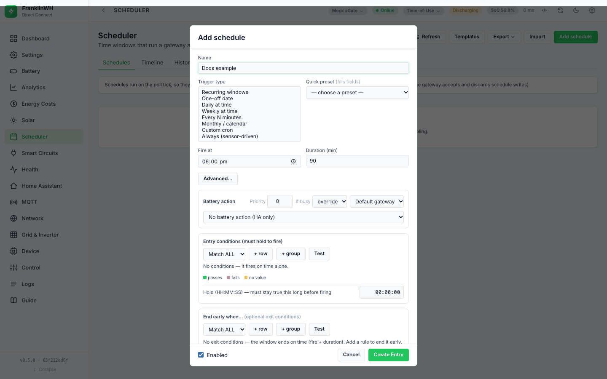
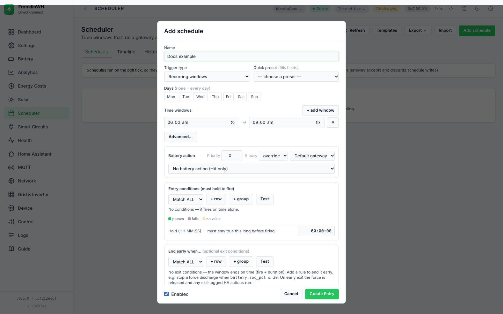

# Triggers

Direct Connect Bridge. Mirrors the Modbus Bridge page
[Triggers](https://david2069.github.io/franklinwh-modbus-bridge/user/scheduler/triggers/) section
for section.

The trigger decides when a schedule's **window** is open. Conditions and actions only matter
while it is open. This page covers starting **by time**; starting **by event** or **by
sensor** is a trigger plus entry conditions (see [Concepts](concepts.md#three-ways-to-start)
and [Conditions](conditions.md)).

## Summary

| Trigger type (UI) | API `trigger_type` | Fields in the form | Window |
|---|---|---|---|
| Recurring windows | `window` | Days, one or more time windows | inside any window, on the ticked days |
| One-off date | `once` | Date, Fire at, Duration (min) (the form also shows Time windows; see the warning below) | Fire at → + duration, on that date |
| Daily at time | `daily` (the default) | Fire at, Duration (min) | Fire at → + duration, every day |
| Weekly at time | `weekly` | Days, Fire at, Duration (min) | Fire at → + duration, on the ticked days |
| Every N minutes | `interval` | Every (min), Anchor, Duration (min) | each slot → + duration |
| Monthly / calendar | `monthly` | Day of month, Months, Fire at, Duration (min) | Fire at → + duration, on that day |
| Custom cron | `cron` | Cron expression, Duration (min) | each cron match → + duration |
| Always (sensor-driven) | `always` | — | while the entry conditions hold |

Every trigger also honours the calendar restrictions **Days**, **Months**, **Day of month**,
**Start date** and **End date** when they are set: each one is a restriction, and an empty one
means "no restriction". The form shows only the ones that belong to the chosen type, plus a
date range under **Advanced…**.
<!-- @b TRG-49 ;; src: scheduler.py:426-455, scheduler.py:1997-2004 ;; untested ;; write: yes ;; b: The tick applies the calendar restrictions (days, months, day of month, date range) to every trigger type, interval, cron and always included ;; test: unit: interval entry with days [0] is not due on a Tuesday; always entry with an end_date in the past never fires -->

**Not in this bridge:** the legacy / v2 distinction. Every schedule has a `trigger_type`
(`daily` when none is stored) and is evaluated the same way. See
[Concepts](concepts.md#legacy-and-v2-entries).

## Fire-based triggers: the active window

For Daily, Weekly, One-off and Monthly the window is **Fire at** → **Fire at + Duration
(min)** on each allowed day. For Every N minutes it is each slot → slot + duration, and for
Custom cron each match → match + duration.
<!-- @b TRG-01 ;; src: scheduler.py:297-321, scheduler.py:369-392 ;; tested: tests/test_scheduler.py::test_due_reports_why_it_did_not_fire ;; write: yes ;; b: A fire-based entry is open from Fire at to Fire at + duration_min (each slot or cron match for interval and cron) ;; test: -->

!!! warning "Duration (min) 0 means one minute"
    With a duration of 0, a Daily, Weekly, One-off or Monthly window is open only during the
    **Fire at** minute; an Every N minutes or cron window is open for one minute. That is
    enough for a one-shot action (a mode, a notification). A force sent in that minute is
    started with **no time limit** (the force's own timer is the duration, 0 = none), and is
    released by the window's end edge on the next tick after the minute. Set a duration for
    force actions.
<!-- @b TRG-02 ;; src: scheduler.py:314-317, scheduler.py:332-366, scheduler.py:2409-2413, scheduler.py:2011-2033 ;; untested ;; write: yes ;; b: A duration of 0 opens the window for the one Fire at minute (one minute for interval and cron); a force sent then has no timer and is released at the next tick after the minute ;; test: unit: tick a duration-0 force entry at hh:mm:10 and hh:(mm+1):10; assert Force then Release -->

!!! note "Duration (min) is not the same as Hold (HH:MM:SS)"
    *Duration (min)* sits with the trigger and sets how long the window stays open.
    *Hold (HH:MM:SS)* sits under the entry conditions and is the
    [hold time](conditions.md#hold-for-dwell).

All time triggers work to the minute: the engine compares `hour × 60 + minute`, so seconds
play no part.
<!-- @b TRG-03 ;; src: scheduler.py:265-270, scheduler.py:384 ;; untested ;; write: no ;; b: Window tests compare minute-of-day; seconds are ignored ;; test: unit: window_now at 18:00:59 and 18:01:00 for a 18:00 duration-1 entry -->

## Recurring windows

1. Tick the **Days** ("none = every day").
2. Type a **start → end** time. **+ add window** adds another; **×** removes one.

| Field | Values | Notes |
|---|---|---|
| Days | Mon … Sun, any combination | None ticked = every day. |
| Time windows | start → end, `HH:MM` | Any window matching opens the schedule. |

- The window is open from *start* up to, but not including, *end*.
  <!-- @b TRG-04 ;; src: scheduler.py:314-321 ;; untested ;; write: yes ;; b: A window is open from start up to but not including end ;; test: unit: window_now at the end minute is outside -->
- **None ticked = every day.** A day not ticked is skipped.
  <!-- @b TRG-05 ;; src: scheduler.py:443-445 ;; tested: tests/test_scheduler.py::test_recurrence_days_of_week ;; write: yes ;; b: An empty days list means every day; a weekday not in the list is blocked with the reason 'not one of its days of the week' ;; test: -->
- **Several windows** on one schedule: it is open inside any of them, and **each window is
  its own occurrence**, so a schedule with a morning and an evening window fires once in each.
  <!-- @b TRG-06 ;; src: scheduler.py:297-311, scheduler.py:385-391 ;; tested: tests/test_scheduler.py::test_trigger_window_multiple_windows ;; write: yes ;; b: Several windows: open inside any; window 0 uses the date as its key and window N uses date#N, so each fires once a day ;; test: -->
- **End at or before start wraps past midnight.** `22:00 → 06:00` runs overnight.
  <!-- @b TRG-07 ;; src: scheduler.py:307, scheduler.py:318-321 ;; untested ;; write: yes ;; b: A window whose end is at or before its start wraps past midnight ;; test: unit: window_now for a 22:00-06:00 window at 23:00 and 01:00 (the existing midnight tests use window_state, which only /test uses) -->
- **The day check uses the day the window opened.** With only **Wed** ticked,
  `22:00 → 02:00` runs Wednesday 22:00 to Thursday 02:00; the after-midnight part belongs to
  Wednesday. It does **not** run Wednesday 00:00–02:00.
  <!-- @b TRG-08 ;; src: scheduler.py:324-329, scheduler.py:385-391, scheduler.py:1997-1998 ;; untested ;; write: yes ;; b: For an overnight window the calendar is checked against the date the window opened, so the after-midnight part belongs to the previous day ;; test: unit: Wed-only 22:00-02:00 due at Thu 01:00 true and Wed 01:00 false (the existing test covers _window_anchor_date, which nothing calls) -->
- **Start equal to end is a 24-hour window**, not an empty one: `18:00 → 18:00` is open all
  day.
  <!-- @b TRG-09 ;; src: scheduler.py:307 ;; unclear ;; write: yes ;; b: A window with start equal to end is read as 24 hours and is always open ;; test: unit: decide whether start == end should match nothing (Modbus Bridge) or 24 h, then assert it -->
- **`24:00` is the end of the day.** `18:00 → 24:00` runs to midnight. A time that does not
  parse drops that window; if no window parses, the schedule falls back to **Fire at** +
  **Duration (min)** (both hidden for this type in the form, default 18:00 and 90).
  <!-- @b TRG-10 ;; src: scheduler.py:265-270, scheduler.py:301-311 ;; untested ;; write: yes ;; b: Times parse as h*60+m, so 24:00 is minute 1440; unparsable windows are dropped and an empty list falls back to fire_at + duration_min ;; test: unit: 18:00-24:00 open at 23:59; window list [] falls back to fire_at -->

**Direct Connect only.** **Advanced…** restricts any recurring type to a **Start date** and an
**End date**. A day outside the range is blocked with the reason "before start date …" or
"after end date …", which **Test against live** shows.
<!-- @b TRG-50 ;; src: scheduler.py:430-442, scheduler.py:535-537, templates/tabs/scheduler.html:509-522 ;; tested: tests/test_scheduler.py::test_due_reports_recurrence_reason ;; write: yes ;; b: A calendar restriction that blocks today is reported as the reason in due() ;; test: -->

## One-off date window

| Field | Values | Notes |
|---|---|---|
| Date | a calendar date | Saving copies it to both Start date and End date. |
| Fire at, Duration (min) | `HH:MM`, minutes | The window that runs on that date. |

- The schedule runs only on that date. The form hides **Days**, but a Days list saved earlier
  on the schedule still applies.
  <!-- @b TRG-11 ;; src: static/js/scheduler_tab.js:546, scheduler.py:430-445 ;; tested: tests/test_scheduler.py::test_recurrence_date_range_and_one_off ;; write: yes ;; b: A one-off is start_date == end_date; it is open only on that date (days, if stored, still restrict) ;; test: -->
- It never fires after the date. **Next:** shows "—" afterwards; the card keeps saying
  "once on <date>".
  <!-- @b TRG-12 ;; src: scheduler.py:458-506, static/js/scheduler_tab.js:715, static/js/scheduler_tab.js:732 ;; tested: tests/test_scheduler.py::test_recurrence_date_range_and_one_off ;; write: yes ;; b: After its date a one-off never opens again and next_fire is None ;; test: -->
- An overnight window covers both dates: Fire at `22:00`, Duration `240` on 20 October runs
  20 October 22:00 to 21 October 02:00, because the after-midnight part belongs to the day it
  opened.
  <!-- @b TRG-13 ;; src: scheduler.py:324-329, scheduler.py:385-391 ;; untested ;; write: yes ;; b: An overnight one-off runs past midnight into the next date, attributed to its own date ;; test: unit: once 22:00+240 on D, due at D+1 01:00 is true -->

!!! warning "One-off: the Time windows in the form are ignored, and no date means every day"
    For **One-off date** the form shows **Time windows** as well as **Fire at** and
    **Duration (min)**. The engine uses only Fire at and Duration: windows are read for
    **Recurring windows** alone. And a One-off saved **without a date** has no date
    restriction, so it fires **every day**. Issue #198.
    <!-- @b TRG-51 ;; src: scheduler.py:297-311, templates/tabs/scheduler.html:435-464, scheduler.py:430-442 ;; unclear ;; write: yes ;; b: A once entry ignores its windows list (only window type reads windows) and with no start_date it fires every day ;; test: unit: once with windows [18:00-19:00] and fire_at 06:00 is open at 06:00, not 18:30; once with no date is due daily -->

## Daily at time

| Field | Values |
|---|---|
| Fire at | `HH:MM` |
| Duration (min) | 0 to 1440 in the form (0 = one minute) |

Fires once a day, on each day the calendar restrictions allow. A schedule that has already
fired this occurrence does not fire again until the next one.
<!-- @b TRG-14 ;; src: scheduler.py:369-392, scheduler.py:538-541 ;; tested: tests/test_scheduler.py::test_fires_once_per_day ;; write: yes ;; b: Daily opens every day at fire_at and fires at most once per date key ;; test: -->

The form caps **Duration (min)** at 1440 for these types; the API does not cap it. Longer
durations have not been tested.
<!-- @b TRG-15 ;; src: templates/tabs/scheduler.html:462-463, app.py:633 ;; untested ;; write: yes ;; b: duration_min has no upper bound in the API (the form input has max 1440) ;; test: unit: a 2000-minute daily window: decide and assert how occurrences overlap -->

## Weekly at time

| Field | Values | Notes |
|---|---|---|
| Days | Mon … Sun | None ticked = **every day**. |
| Fire at | `HH:MM` | |
| Duration (min) | 0 or more | |

Weekly is Daily with a **Days** restriction. With no days ticked it runs every day.
<!-- @b TRG-16 ;; src: scheduler.py:443-445 ;; tested: tests/test_scheduler.py::test_recurrence_empty_fires_every_day ;; write: yes ;; b: A weekly trigger with no days has no restriction and fires every day ;; test: -->

## Every N minutes

| Field | Values | Notes |
|---|---|---|
| Every (min) | 1 or more in the form | Stored as `interval_min`. |
| Anchor | `HH:MM`, optional | Slots are counted from this time. Empty = midnight. |
| Duration (min) | 0 or more | 0 = one minute. |

- Slots land on *anchor + k × N*, counted from today's anchor (or yesterday's, before the
  anchor time). With N = 30 and no anchor: 00:00, 00:30, 01:00 …
  <!-- @b TRG-17 ;; src: scheduler.py:332-347 ;; tested: tests/test_scheduler.py::test_trigger_interval ;; write: yes ;; b: Interval slots are anchor + k*interval_min from the most recent anchor; each slot opens for duration_min (1 when 0) ;; test: -->
- **The count restarts at the anchor every day.** If N does not divide 24 hours the last gap
  of the day is shorter: every 25 minutes from midnight has a slot at 23:45, then 00:00.
  <!-- @b TRG-18 ;; src: scheduler.py:338-343 ;; untested ;; write: yes ;; b: The interval series restarts at the anchor each day, so a period that does not divide 24 h has a short final gap ;; test: unit: 25-minute interval open at 23:45 and 00:00 -->
- **24 hours or more** opens once a day at the anchor. **Next:** disagrees: it shows anchor + N
  rather than the next anchor.
  <!-- @b TRG-19 ;; src: scheduler.py:332-347, scheduler.py:467-476 ;; unclear ;; write: yes ;; b: An interval of 1440 min or more opens daily at the anchor, but next_fire_ts reports anchor + interval ;; test: unit: 1500-min interval anchored 06:00: window_now and next_fire_ts agree -->
- An interval of 0 or less never opens. The API does not reject it; the form's field has a
  minimum of 1.
  <!-- @b TRG-20 ;; src: scheduler.py:333-335, scheduler.py:468-470, templates/tabs/scheduler.html:485-486 ;; untested ;; write: no ;; b: interval_min 0 or less never opens and next_fire is None; not rejected at save ;; test: unit: window_now and next_fire_ts with interval_min 0 -->

## Monthly / calendar

| Field | Values | Notes |
|---|---|---|
| Day of month | 1–31 | Clamped to the month's length: 31 fires on 30 April and 28/29 February. |
| Months | Jan … Dec | None = every month. |
| Fire at | `HH:MM` | Default 00:00 through the API. |
| Duration (min) | 0 or more | |

<!-- @b TRG-21 ;; src: scheduler.py:446-454 ;; tested: tests/test_scheduler.py::test_recurrence_months_and_day_of_month_with_clamp ;; write: yes ;; b: Day of month is clamped to the month length; months restrict; empty months = all ;; test: -->

- The API does not check the day or the months. A day of `0` or none means "no day
  restriction".
  <!-- @b TRG-22 ;; src: app.py:656-657, scheduler.py:449-454 ;; untested ;; write: yes ;; b: day_of_month and months are not range-checked; 0 or null day_of_month is no restriction ;; test: unit (API): POST day_of_month 0 and months [13]; decide whether to reject -->
- **A Monthly schedule with no Day of month runs every day** at Fire at (in the listed
  months). Pick a day.
  <!-- @b TRG-23 ;; src: scheduler.py:449-454 ;; untested ;; write: yes ;; b: A monthly trigger with no day_of_month has no day restriction and fires every day ;; test: unit: monthly with day_of_month None due on any day -->

The quick presets use this trigger: *Monthly (1st)*, *Quarterly (1st)* (Jan, Apr, Jul, Oct)
and *Annually (Jan 1)*.

## Custom cron

| Field | Values |
|---|---|
| Cron expression | five fields: minute, hour, day of month, month, day of week |
| Duration (min) | 0 or more (0 = one minute) |

| Expression | Fires |
|---|---|
| `*/15 * * * *` | every 15 minutes |
| `0 17 * * 1-5` | 17:00 Monday–Friday |
| `0 3 * * *` | 03:00 every day (the form's default) |

- Custom cron needs the `croniter` package. Without it the option reads *Custom cron —
  unavailable* and cannot be picked.
- **The expression is not checked when you save.** An invalid or empty one never opens, and
  **Next:** shows "—".
  <!-- @b TRG-24 ;; src: scheduler.py:350-366, scheduler.py:477-485, templates/tabs/scheduler.html:410 ;; untested ;; write: no ;; b: An invalid or empty cron expression is accepted at save and never opens ;; test: unit (API): POST cron 'nonsense' (decide whether to reject); unit: window_now outside -->
- **Day of week counts from Sunday = 0** in cron (croniter), unlike **Days** and the weekday
  restriction, where Monday = 0.
  <!-- @b TRG-25 ;; src: scheduler.py:355-358, scheduler.py:444 ;; untested ;; write: yes ;; b: Cron day-of-week follows croniter (0 = Sunday), unlike days (0 = Monday) ;; test: unit: '0 18 * * 0' open on a Sunday 18:05, closed Monday -->
- Each match opens the window for **Duration (min)** from the match minute.
  <!-- @b TRG-26 ;; src: scheduler.py:350-366 ;; tested: tests/test_scheduler.py::test_trigger_cron ;; write: yes ;; b: A cron entry is open from the previous match for duration_min (1 when 0); next fire is the next match ;; test: -->
- Cron, Every N minutes and Always schedules are not drawn on the Timeline.

## Always evaluate

The form calls it **Always (sensor-driven)**: "No time trigger — this dispatches whenever the
entry conditions hold and releases when they stop." The window is open while the entry
conditions hold. The schedule fires on the rising edge only, not on every tick.
<!-- @b TRG-27 ;; src: scheduler.py:1999-2002, scheduler.py:2049-2051 ;; tested: tests/test_scheduler.py::test_trigger_always_fires_on_rising_edge ;; write: yes ;; b: An always entry's window is open while its entry conditions hold; it fires on the rising edge and not again while they keep holding ;; test: -->

When the conditions stop holding, the window closes: exit HA actions run and, for a force
action, a Release is sent.
<!-- @b TRG-30 ;; src: scheduler.py:2014-2033 ;; tested: tests/test_scheduler.py::test_trigger_always_fires_on_rising_edge ;; write: yes ;; b: When an always entry's conditions stop, the closing edge sends a force Release and runs exit HA actions ;; test: -->

!!! danger "Always fires once, ever, and then only releases"
    The run of an Always schedule is stored as one occurrence with the fixed key `always`.
    After the first successful run that occurrence is finished, so **every later rising edge
    sends nothing**. Probe, 2026-10-17, against this release's code: SoC 95 → 50 → 95 → 95 →
    50 → 95 gave Force Discharge, Release, nothing, nothing, Release, nothing.

    - The **falling** edges still send **Release**, which ends whatever force is running on
      that gateway, even one this schedule did not start (see
      [Exit and release](exit-and-conflicts.md#how-a-run-ends)).
    - The mark is kept in the database. A restart, an edit, or turning it off and on does
      not clear it; nothing prunes old runs (the prune function exists but is never called).
      Deleting the schedule and creating it again does.
    - An Always schedule with **no battery action** sends its HA actions once, ever, too.

    For "whenever the price is low" rules use a repeating trigger with a gap, for example
    **Custom cron** `*/30 * * * *` with **Duration (min)** 29. Issue #190.
<!-- @b TRG-28 ;; src: scheduler.py:378-379, scheduler.py:2147-2150, db.py:1935-1962 ;; unclear ;; write: yes ;; b: An always entry's occurrence key is the constant 'always'; once it finishes ok it is terminal, so the entry never fires again ;; test: unit: tick an always force entry through two rising edges; assert a second Force (fails today) -->
<!-- @b TRG-29 ;; src: db.py:1935-1962, db.py:2202-2212 ;; unclear ;; write: yes ;; b: The fired-once mark for always is a stored occurrence row per schedule and gateway; it survives restart, edit and disable, and prune_occurrences is never called ;; test: unit: after restart (fresh in-memory state, same DB) the always entry still does not fire -->

## Quick presets

A **Quick preset** fills the trigger fields; you can edit them afterwards. It clears Days,
Months, Day of month and Time windows first.
<!-- @b TRG-31 ;; src: static/js/scheduler_tab.js:676-697 ;; untested ;; write: no ;; b: Quick presets reset days, months, day_of_month and windows, then set only trigger fields ;; test: browser: apply 'Weekdays 18:00' over a monthly form; assert months cleared -->

| Preset | Sets |
|---|---|
| Every 15 minutes, Every 30 minutes, Hourly | Every N minutes, N = 15, 30, 60 |
| Every day 08:00 | Daily at 08:00 |
| Weekdays 18:00 | Weekly, Mon–Fri, 18:00 |
| Weekly (Sun) 00:00 | Weekly, Sunday, 00:00 |
| Monthly (1st), Quarterly (1st), Annually (Jan 1) | Monthly, day 1, months as named, 00:00 |
| Nightly 03:00 (cron) | Custom cron `0 3 * * *` |

## Next fire

**Next:** on each card is worked out by the bridge (`next_fire` in `GET /api/schedules`):

| Trigger | Next fire |
|---|---|
| Recurring windows, Daily, Weekly, One-off, Monthly | the earliest window start from today, looking up to a year ahead. While today's window is open and has not fired, that is the current window ("in its window"). |
| Every N minutes | the next slot |
| Custom cron | the next match |
| Always, a disabled schedule, or one that can never fire | — (*disabled* when off) |

<!-- @b TRG-32 ;; src: scheduler.py:458-506, app.py:3033-3038, static/js/scheduler_tab.js:510-529 ;; tested: tests/test_scheduler.py::test_next_fire_and_active_now ;; write: no ;; b: next_fire is the next window start within 366 days (skipping a fired or ended window today); next slot for interval; next match for cron; None for always or disabled ;; test: -->

**● active** on a card means: enabled, inside its window **and already fired** this
occurrence. It is never shown for Always schedules.
<!-- @b TRG-33 ;; src: scheduler.py:509-520 ;; tested: tests/test_scheduler.py::test_next_fire_and_active_now ;; write: no ;; b: active_now = enabled, inside the window and last_fired_day equals this occurrence; always is never active_now ;; test: -->

!!! warning "Next and ● active use the container's clock"
    `GET /api/schedules` computes `next_fire` and `active_now` with the bridge container's
    clock, while the scheduler fires on the site's clock (see
    [Restarts and the clock](restarts-and-clock.md#the-clock)). When the two zones differ,
    **Next:**, **● active** and therefore the **Stop** button are off by the difference. The
    browser then formats the time in **its** zone. Issue #161.
<!-- @b TRG-52 ;; src: app.py:3033-3038, static/js/scheduler_tab.js:510-529 ;; unclear ;; write: no ;; b: next_fire and active_now are computed on the container's naive clock, not the site clock the tick uses ;; test: unit (API): container UTC, site UTC-5; assert next_fire matches the site window -->

## Editing a trigger in the form

- Switching a schedule to **Recurring windows** hides **Duration (min)** but keeps its value
  (a new schedule starts with 90). The window ignores it for timing, but a **force** action
  still uses it as its time limit, and so does **Run now**. Issue #160.
  <!-- @b TRG-34 ;; src: static/js/scheduler_tab.js:243-250, static/js/scheduler_tab.js:656, scheduler.py:2409-2413, scheduler.py:1578-1581 ;; unclear ;; write: yes ;; b: A window entry keeps a hidden duration_min (default 90) that becomes the force's duration_s, so a force stops before a longer window ends ;; test: unit: window 17:00-20:00 force; assert duration_s covers the window (fails today: 5400) -->
- **Not in this bridge:** an API-only one-off type (`oneoff` with an ISO `fire_at`). Saving a
  **One-off date** schedule copies the date into **Start date** and **End date**.
- Switching to **Recurring windows** with no window adds `06:00 → 09:00`; switching to Every N
  minutes or Custom cron fills 30 minutes or `0 3 * * *` when empty.
  <!-- @b TRG-53 ;; src: static/js/scheduler_tab.js:669-674 ;; untested ;; write: no ;; b: Changing the trigger type seeds a 06:00-09:00 window, 30 min interval or '0 3 * * *' cron when empty ;; test: browser: switch types and read the form -->

## After an outage or a restart (catch-up)

**Not in this bridge.** There is no outage record and no catch-up: a window that closes
without a successful run is logged *missed*, and is **never run late**. There is no **If missed
during an outage** setting (#162 lists catch-up as a possible feature).
<!-- @b TRG-54 ;; src: scheduler_worker.py:119-145, db.py:2102-2131 ;; untested ;; write: yes ;; b: There is no late fire: a missed window is only logged, never run afterwards ;; test: unit: window closes while the gateway is stale; assert no action after it reopens -->

What happens instead:

- **Stale data stops evaluation.** A gateway whose stored values are older than three poll
  intervals (at least 90 seconds), or that has never polled, is not evaluated at all on that
  tick. Its windows can close without a run.
  <!-- @b TRG-55 ;; src: scheduler_worker.py:82-104, scheduler_worker.py:156-160 ;; tested: tests/test_scheduler_worker.py::test_stale_gateways_are_not_passed_to_tick_at_all ;; write: yes ;; b: A gateway whose snapshot is older than max(90 s, 3 poll intervals), or never polled, is skipped and not evaluated ;; test: -->
- **Missed.** Every tick, runs that were claimed but not finished (*pending*, *running*,
  *failed*) whose window ended more than **120 seconds** ago are closed as *missed*, logged
  with the number of attempts.
  <!-- @b TRG-40 ;; src: scheduler_worker.py:39, scheduler_worker.py:119-145, db.py:2102-2131 ;; tested: tests/test_occurrences.py::test_a_run_whose_window_closed_while_pending_is_missed ;; write: no ;; b: Claimed runs whose window ended more than 120 s ago without success are marked missed and logged ;; test: -->
- A window that opened and closed entirely while the gateway was stale, or while the bridge was
  down, was never claimed, so it leaves **no** *missed* row.
  <!-- @b TRG-41 ;; src: scheduler.py:2142-2156, db.py:2102-2131 ;; untested ;; write: no ;; b: A window never seen by a tick is never claimed and so never reported missed ;; test: unit: no tick during a window; sweep reports nothing -->
- **Coalesced.** When a run is claimed while older runs of the same schedule on the same
  gateway are still open, the older ones are closed as *skipped* and logged *coalesced*: the
  backlog is done once, not replayed.
  <!-- @b TRG-56 ;; src: scheduler.py:2330-2346, db.py:1964-2000 ;; tested: tests/test_occurrences.py::test_an_older_open_run_is_collapsed_into_the_newer_one ;; write: yes ;; b: Older open runs of the same schedule and gateway are closed as skipped (coalesced) when a newer run is claimed ;; test: -->
- After a restart, a schedule that already fired in the current occurrence does not fire
  again (the occurrence is stored); one that has not fired is evaluated afresh. See
  [Restarts and the clock](restarts-and-clock.md).

The clock that all of this runs on is described in
[Restarts and the clock](restarts-and-clock.md).
